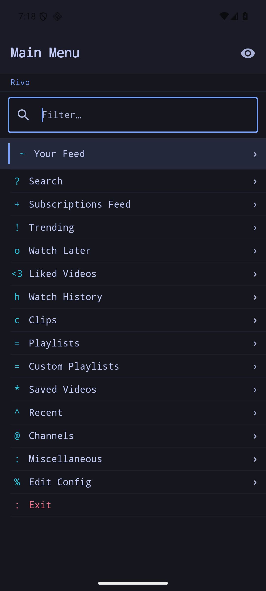

<div align="center">
<h1>Rivo</h1>
<p><em>YouTube, como una lista.</em></p>
<p>
<a href="LICENSE"></a>
<a href="#instalar"></a>
<a href="#instalar"></a>
</p>
<p><a href="README.md">English</a> · <a href="README.es.md">Español</a></p>
<p></p>
</div>

Rivo es una app de YouTube para Android. No tiene un inicio lleno de recomendaciones que intentan
adivinar qué quieres ver. Abre una lista sencilla de secciones —tus suscripciones, tus listas, tu
historial— y un buscador.

Escribes, la lista se acorta y eliges algo. El mismo gesto funciona en todas partes: en el menú
principal, dentro de un canal, en tus vídeos guardados.

Si conoces [yt-x](https://github.com/Benexl/yt-x), el navegador de YouTube para terminal, esto es
la misma idea en un teléfono. Rivo no es una capa encima del script: es una app nativa de Android,
así que las cosas que una terminal no puede hacer aquí sí funcionan.

## Qué puedes hacer

Los vídeos se reproducen en la resolución que elijas, con sonido, hasta 4K. Cierras el reproductor
y el audio sigue; bloqueas el teléfono y sigue; la notificación y los auriculares lo controlan.

Las descargas se comportan como esperas. Empiezas una y sales de la app: sigue en segundo plano,
sobrevive a un reinicio y se puede pausar, reanudar o cancelar. Al terminar, el archivo aparece en
tu carpeta de Vídeos o Música.

Todo lo que marcas —recientes, vídeos guardados, listas, suscripciones— se queda en el teléfono.
No hay cuenta que crear y no se envía nada a ningún lado.

Y cuando quieres cambiar algo, los ajustes también son menús normales: temas, idioma, tamaño de
página, cookies, dónde se guardan los archivos.

## Instalar

Descarga el último APK desde [Releases](https://github.com/iseaprojects/rivo/releases) y ábrelo.
Android te avisará de que estás instalando una app de fuera de Play. Ese aviso es normal.

Hay dos versiones. La pequeña es para YouTube. La grande añade otros sitios, y es la que quieres
si usas Rivo para algo más que YouTube.

## Compilar

Necesitas JDK 17 y Android SDK 37.

```bash
git clone https://github.com/iseaprojects/rivo
cd rivo
./gradlew :app:assembleFastDebug     # compilación pequeña
./gradlew :app:assembleYtdlpDebug    # con otros sitios
```

La compilación `fast` es la pequeña. La `ytdlp` es la que trae los sitios extra. Ambas son de
depuración; para una firmada usa `tools/release.sh`, que lee las claves de tu entorno o de un
archivo `keystore.properties` que mantienes fuera del repositorio.

## Una nota sobre la responsabilidad

Rivo reproduce lo que ya tienes permitido ver. No rompe DRM, muros de pago, controles de edad ni
bloqueos regionales; cuando encuentra uno, te lo dice y se detiene. Las cookies están para que
aparezcan tus propias suscripciones, no para hacerte pasar por otra persona.

Nada de esto anula los términos de servicio de los sitios que lee. Esa parte es tuya.

## Más información

- [Arquitectura](docs/ARCHITECTURE.md): cómo encajan las piezas.
- [Enlaces profundos](docs/DEEPLINKS.md): los enlaces `rivo://` que otras apps pueden usar.
- [Decisiones](docs/DECISIONS.md): por qué las cosas son como son.
- [Extractores](docs/EXTRACTORS.md): los dos motores, uno al lado del otro.
- [Verificación](docs/VERIFICATION.md): qué se probó y cómo.
- [Contribuir](CONTRIBUTING.md) · [Seguridad](SECURITY.md)

## Créditos

Rivo es una versión de [yt-x](https://github.com/Benexl/yt-x) de Benexl y conserva su licencia MIT
y su aviso de copyright. No está afiliada a YouTube ni al proyecto original.
