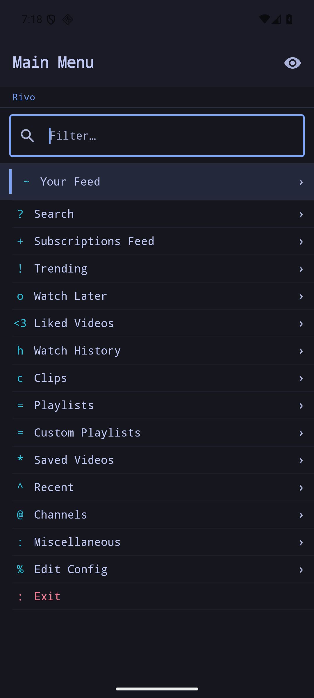

<div align="center">
<h1>Rivo</h1>
<p><em>YouTube, as a list.</em></p>
<p>
<a href="LICENSE"></a>
<a href="#install"></a>
<a href="#install"></a>
</p>
<p><a href="README.md">English</a> · <a href="README.es.md">Español</a></p>
<p></p>
</div>

Rivo is a YouTube app for Android. It has no home feed trying to guess what you want to watch. It
opens a plain list of sections — your subscriptions, your playlists, your history — and a search
box.

You type, the list narrows, and you pick something. That same gesture works everywhere: in the
main menu, inside a channel, in your saved videos.

If you know [yt-x](https://github.com/Benexl/yt-x), the terminal YouTube browser, this is the same
idea on a phone. Rivo is not a skin over the script: it is a native Android app, so the things a
terminal cannot do actually work here.

## What you can do

Videos play at the resolution you pick, with sound, up to 4K. Close the player and the audio keeps
going; lock the phone and it keeps going; the notification and your headphones control it.

Downloads behave like you would expect. Start one and leave the app: it continues in the
background, survives a restart, and can be paused, resumed or cancelled. Finished files land in
your Movies or Music folder.

Everything you mark — recents, saved videos, playlists, subscriptions — stays on the phone. There
is no account to create, and nothing is sent anywhere.

When you want to change something, the settings are ordinary menus too: themes, language, page
size, cookies, where files go.

## Install

Download the latest APK from [Releases](https://github.com/iseaprojects/rivo/releases) and open it.
Android will warn you about installing apps from outside Play. That warning is normal.

There are two versions. The small one is for YouTube. The bigger one adds other sites, and is the
one to pick if you use Rivo for more than YouTube.

## Build

You need JDK 17 and Android SDK 37.

```bash
git clone https://github.com/iseaprojects/rivo
cd rivo
./gradlew :app:assembleFastDebug     # small build
./gradlew :app:assembleYtdlpDebug    # with other sites
```

The `fast` build is the small one. The `ytdlp` build is the one with the extra sites. Both are
debug builds; for a signed one, use `tools/release.sh`, which reads the keys from your environment
or from a `keystore.properties` file you keep out of the repo.

## A note on responsibility

Rivo plays what you are already allowed to watch. It does not break DRM, paywalls, age gates or
region locks; when it finds one, it tells you and stops. Cookies are there so your own
subscriptions appear, not to pretend to be someone else.

Nothing here overrides the terms of service of the sites it reads. That part is yours.

## Learn more

- [Architecture](docs/ARCHITECTURE.md) — how the pieces fit together.
- [Deep links](docs/DEEPLINKS.md) — the `rivo://` links other apps can use.
- [Decisions](docs/DECISIONS.md) — why things are the way they are.
- [Extractors](docs/EXTRACTORS.md) — the two backends, side by side.
- [Verification](docs/VERIFICATION.md) — what was tested, and how.
- [Contributing](CONTRIBUTING.md) · [Security](SECURITY.md)

## Credits

Rivo is a port of [yt-x](https://github.com/Benexl/yt-x) by Benexl, and keeps its MIT license and
copyright notice. It is not affiliated with YouTube or with the upstream project.
